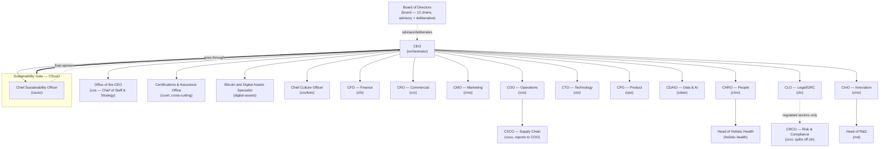

# Org Chart — TRANSITION-ORGANIZATIONS

## Notes

- `csco` reports to `coo` in the narrative organizational hierarchy, but is its own agent in
  Claude Code due to its technical depth (Section 1.1 of the specification).
- `rnd` reports to `cino`; `holistic-health` reports to `chro`. Both are their own subagents,
  triggered by the CEO when the owning C-Level requests it in the RETURN (or alongside it) — the
  hierarchy is preserved by the request flow, not by subagent nesting.
- `digital-assets` reports to the CEO, with a dotted line to `cfo`, `clo`, `csuso`, `cto`, and
  `board`.
- `cculture` reports to the CEO.
- `csuso` is the Sustainability Gate: every decision goes through it before being final.
- `board` is always accessible to the CEO in advisory mode, and deliberates on one-way doors.
- `crco` (Chief Risk & Compliance Officer) is activated only for regulated sectors (financial
  services, healthcare, energy) per `company-profile.md`; when inactive, its duties (integrity,
  enterprise risk) stay inside `clo`.
